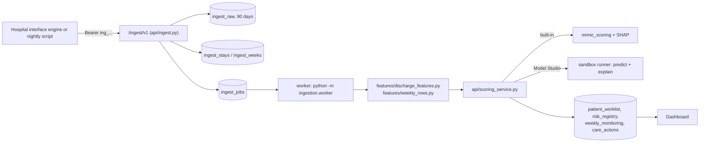

# Pilot ingestion: build plan for the week of 19 October 2026

**Goal for the end of the week.** A pilot hospital sends its own discharges and weekly check-ins
to Preventra. They are scored by the model the hospital trained and deployed in Model Studio, or by
our built-in model until it has one. They then appear on that hospital's dashboard with a score,
a band, three drivers and a condition group, within a minute and without anyone running a script.

Four pieces make that work. They are listed in build order, because each depends on the one before:

| | Workstream | Why it is needed |
|---|---|---|
| A | Shared feature builder | The training CSV and live scoring must be built by the same code, or the live inputs will not match what the model learned |
| B | Ingest API | The hospital needs a way to send data that is not a person uploading files |
| C | Scoring worker and the path into the dashboard | A deployed Model Studio model today only scores files in its own tab; nothing writes to the worklist |
| D | Explanations for Model Studio models | Only our built-in model can say why a patient scored high (SHAP); a hospital's own model cannot |

**Before starting:** merge `main` into `ReadmissionDataPipeline`. Commit `a4cda07` (weekly
monitoring aligned with the discharge diagnosis) is on `main` only, and workstream C depends on it.

> **Status, 15 October 2026: A to D are built** on `readmission-case-manager` (on top of `main`, so
> `a4cda07` is included). See [Implementation notes](#implementation-notes) at the end for the
> runbook, where the build differs from this plan, and the known limitations.
>
> **19 October 2026: continuous ingestion added** - each hospital's own columns, uploads from the
> app, history-only loads, database pulls, an on-site agent, and re-scoring after a new model is
> deployed. See [Continuous ingestion](#continuous-ingestion-19-october-2026) at the end.

---

## 0. Decisions this plan rests on

1. **Machine-to-machine routes live under `/ingest/v1/`, not `/api/`.** The user-token dependency
   (`auth.user_dependency`) protects every path that starts with `/api/`. A hospital's interface
   engine has no user token, so ingest gets its own prefix and its own credential. `/ingest/` is
   added to `_skips_api_key` in `api/main.py`; the frontend `API_KEY` ships in the public bundle
   and must never be what authenticates a hospital.
2. **The hospital comes from the credential, never from the request body.**
3. **Rolling batch.** The dashboard shows only the newest `batch_date` across the whole
   `patient_worklist` collection (`_latest_batch()` in `api/main.py`, about 60 call sites).
   Ingested rows are therefore written with the **current latest** `batch_date`, not today's date;
   a new date would hide every other patient. Removing batch scoping is a separate, larger change
   and is out of scope.
4. **One worklist row per patient** (their latest discharge), replaced on readmission.
   `risk_registry` keeps every discharge.
5. **Generated model code still runs only in the sandbox runner.** The worker scores Model Studio
   models through `model_studio._score_with`, exactly as the Score tab does. The worker process
   never unpickles a generated model.
6. **Patient ids are prefixed per hospital:** `<prefix>-<patient_key>`, for example
   `CGH-P1931`. The prefix is set on the ingest client. The worklist is shared across hospitals,
   so a bare hospital key could collide.
7. **Pilot instance.** Run this on the separate pilot deployment described in the pilot plan, with
   its own database and secret, and with Gemini features off. Nothing here needs the production
   database.



---

## A. Shared feature builder (days 1 and 2)

### A1. `features/discharge_features.py`, new

This is a port of the Phase 1 notebook (`notebooks/mimic/phase1_discharge_risk_mimic.ipynb`, cells
5, 7, 9, 11, 13–14 and 16) into plain functions. Each takes canonical tables as DataFrames and
contains no MIMIC file paths.

| Function | Input | Output, one row per encounter |
|---|---|---|
| `cohort(encounters, patients)` | stays + people | `n_prior_adm`, `days_since_prev`, `readmit_history`, `prior_adm_flag`, exclusion flags, and `readmit_30d` where the 30 days after discharge are already known (else NaN) |
| `charlson(diagnoses)` | coded diagnoses | 17 Charlson flags, `charlson_score`, `n_diagnoses` |
| `severity(drg, procedures)` | DRG and procedures | `drg_severity`, `drg_mortality` (APR-DRG only), `n_procedures` |
| `medications(meds)` | orders | `n_drug_orders`, `n_distinct_drugs`, five `med_*` flags |
| `labs(labs)` | results, already mapped to the 12 tests and converted units | 48 `lab_<test>_{last,min,max,n_abn}` |
| `assemble(...)` | all of the above | `patient_key`, `encounter_key`, `admit_datetime`, `discharge_datetime`, the **94 features under the exact names in `docs/mimic/mimic_feature_spec.json`**, and `readmit_30d` |

These rules must be carried over exactly. The parity test checks them:

- **Outcome.** The next admission starts 0 to 30 days after this discharge and is not elective. It
  is computed on the full sequence **before** exclusions.
- **Exclusions.** In-hospital death, hospice, observation stays.
- **Prior admissions.** `n_prior_adm` counts every earlier stay of the patient. `readmit_history`
  means `days_since_prev <= 30`.
- **Labs.** Results from ED arrival or admission to discharge. `n_abn` counts results the lab
  flagged abnormal; when there is no flag, use the reference range.
- **Discharge destination.** `disch_home` means home only. `disch_snf` covers skilled nursing,
  rehab and long-term acute care.
- **Missing values stay NaN.** Never impute; the model handles missing values.
- **Categorical values use the vocabulary the built-in model was trained on** (`EW EMER.`,
  `Medicare`, and so on), translated from the hospital's codes by
  `ingestion/mappings/<hospital>.yaml`. Both the built-in model and Model Studio models trained on
  this output can then score it.

**Known issue, deliberately kept for parity.** The notebook's Charlson malignancy pattern
`C[0-2][0-6]` misses C07–C09 and C17–C19 (colon cancer). Keep it so that parity with the trained
model holds, and leave a comment. Fixing it means retraining the model.

### A2. `features/weekly_rows.py`, new

Move `flatten()` from `scripts/export_weekly_training_csv.py` into this module and import it back
into the script. Then add:

- `week_number(discharge_date, week_date)`: `ceil(days / 7)`, minimum 1.
- `weekly_frame(stay, weeks)`: one row per patient-week. It contains the week's readings under the
  `monitoring.*` keys used by `models/monitoring_rules.py`, plus the discharge context (discharge
  score, clinical group, age, sex). Absolute readings are made relative with
  `models/discharge_baseline.relative_observations`: weight becomes `weight_change_kg` and walking
  distance becomes `walk_distance_pct`.

### A3. Training exports

These scripts build Model Studio training CSVs from what the hospital has already sent, so its
first model is trained on exactly the columns live scoring will produce. Both are read-only and
write to `~/Downloads`, never to the repo.

- `scripts/export_discharge_training_csv.py --hospital <id>` reads `ingest_stays` and runs
  `assemble`. Output: one row per discharge, containing `patient_key` (the split id),
  `discharge_datetime` (the time column), `readmit_30d` and the 94 features.
- The `--hospital` option in `scripts/export_weekly_training_csv.py` reads that hospital's
  `ingest_weeks`. Its outcome is `readmitted_within_7d`, taken from `ingest_stays`.

### A4. Tests: `tests/units/test_discharge_features.py`

1. **Parity.** On the MIMIC sample tables (`data/mimic/sample_*.csv`; skip if absent),
   `assemble()` equals the notebook matrix for the same stays, column by column, within 1e-6.
2. **Outcome.** A readmission after an excluded stay still counts. An elective return does not.
3. **No look-ahead.** Removing a patient's later stays does not change any feature of their
   earlier stays. This is the same idea as `studio_runner.check_no_lookahead`.
4. **Unknown category.** An unmapped hospital code becomes `UNKNOWN` and appears in the
   validation report.

**Done when** all four pass and A3 produces a CSV that Model Studio accepts without plan problems.
A Model Studio run on it also scores the built-in model on the same test patients, because all 94
columns are present.

---

## B. Ingest API (days 2 and 3)

### B1. Credentials

- New collection `ingest_clients`, one document per credential:
  ```json
  {"_id": "ic_4f9a2c", "hospital_id": "city-general-hospital", "patient_prefix": "CGH",
   "secret_sha256": "...", "created_by": "admin@...", "created_at": "...",
   "last_used_at": "...", "revoked": false}
  ```
- Token format: `Authorization: Bearer ing_<client_id>.<secret>`. The secret is 32 random bytes
  from `secrets.token_urlsafe`. It is stored hashed, compared with `hmac.compare_digest`, and shown
  only once.
- Admin routes go under `/api/` (user token) in `api/ingest.py`:
  - `POST /api/ingest/clients` with body `{patient_prefix}`. Returns the token once.
  - `GET /api/ingest/clients` lists clients with their last-used time; secrets are never shown.
  - `DELETE /api/ingest/clients/{id}` revokes a client.
  - New action `"manage_ingest": ("superadmin", "hospital_admin")` in `api/access.py`. A hospital
    admin manages only their own hospital's clients, and the server enforces that.

### B2. Routes: `api/ingest.py` with `APIRouter(prefix="/ingest/v1")`

| Route | Body | Returns |
|---|---|---|
| `POST /ingest/v1/encounters` | `{"bundles": [Bundle, ...]}`, at most 500 | `202 {batch_id, accepted, rejected: [{encounter_key, errors}]}` |
| `POST /ingest/v1/weeks` | `{"weeks": [WeekIn, ...]}`, at most 2,000 | `202 {batch_id, accepted, rejected}` |
| `POST /ingest/v1/files` | multipart: `encounters`, `patients`, `diagnoses`, `labs`, `medications`, `procedures`, `drg` and/or `weeks` CSVs, using the pilot data-request formats | same as above. The server joins the tables into bundles and takes the same path. This replaces SFTP for the pilot: the hospital's nightly job is one `curl` |
| `GET /ingest/v1/batches/{batch_id}` | none | `{status, accepted, rejected, scored, failed, errors[]}` |
| `GET /ingest/v1/ping` | none | `{hospital_id, client_id}`, to check that a credential works |

Wiring in `api/main.py`:
- add `or path.startswith("/ingest/")` to `_skips_api_key`
- `app.include_router(ingest.router)`

The route dependency `require_ingest_client` resolves the client and sets
`request.state.ingest = {hospital_id, client_id, patient_prefix}`. It also updates `last_used_at`,
at most once a minute.

**Limits:**
- body at most 10 MB, otherwise `413`
- an `Idempotency-Key` header; the same key within 24 hours returns the first batch's response
- at most 60 requests a minute per client, counted in memory, otherwise `429`

### B3. Schemas (pydantic, in `ingestion/schema.py`)

The field names are the pilot data request, unchanged:

```python
class Encounter(BaseModel):
    encounter_key: str; patient_key: str
    admit_datetime: datetime; discharge_datetime: datetime
    age_years: int = Field(ge=18, le=120); sex: str
    admission_type: str; discharge_disposition: str; died_in_hospital: bool
    payer_class: str | None = None
    ed_arrival_datetime: datetime | None = None; ed_departure_datetime: datetime | None = None
    observation_stay: bool | None = None; planned_admission: bool | None = None
    marital_status: str | None = None; race_ethnicity: str | None = None

class Diagnosis(BaseModel):  icd_code: str; icd_version: Literal[9, 10]; sequence: int; description: str | None = None
class Lab(BaseModel):        test_name: str; value: float; unit: str; result_datetime: datetime
                             loinc_code: str | None = None; abnormal_flag: Literal["H","L","A","N",""] | None = None
                             reference_low: float | None = None; reference_high: float | None = None
class Medication(BaseModel): drug_name: str; order_start_datetime: datetime; rxnorm_or_atc: str | None = None
class Procedure(BaseModel):  procedure_code: str; code_system: str; procedure_datetime: datetime | None = None
class Drg(BaseModel):        drg_system: str; drg_code: str
                             severity_of_illness: int | None = None; risk_of_mortality: int | None = None
class DischargeVitals(BaseModel):   # real week-0 baseline, replacing the simulated one
    weight_kg: float | None = None; spo2: float | None = None; sbp: float | None = None
    heart_rate: float | None = None; walk_metres: float | None = None; pain: int | None = None

class Bundle(BaseModel):
    stage: Literal["provisional", "final"] = "final"
    encounter: Encounter
    diagnoses: list[Diagnosis] = []; labs: list[Lab] = []; medications: list[Medication] = []
    procedures: list[Procedure] = []; drg: Drg | None = None
    discharge_vitals: DischargeVitals | None = None

class WeekIn(BaseModel):
    patient_key: str; encounter_key: str          # the discharge this week follows
    week_date: date
    source: Literal["device", "nurse_call", "patient_app", "pharmacy", "clinic"]
    readings: Readings                            # below
    note: str | None = Field(default=None, max_length=500)
```

`Readings` accepts exactly the keys and values that `models/monitoring_rules.py` scores. Anything
else is rejected, not ignored.

- **Numbers:** `weight_kg` or `weight_change_kg`, `sbp`, `heart_rate`, `spo2`, `temperature_c`,
  `adherence_pct`, `walk_metres` or `walk_distance_pct`, `orthopnoea_pillows`,
  `rescue_inhaler_uses`
- **`refill_status`:** missed, late, collected, not due
- **`followup_status`:** missed, attended, not due
- **`ankle_swelling`:** none, mild, marked
- **`sputum_change`:** none, volume, purulent, both
- **`wound_status`:** clean, red, discharge, opening
- **`pain_trend`:** improving, unchanged, worse
- **`antibiotic_course`:** completed, ongoing, stopped_early, not_prescribed
- **`new_confusion`:** yes, no

**Validation beyond types:**
- discharge after admission
- ages capped at 90
- each record's codes mapped through the hospital's mapping file
- `week_date` after the discharge it follows

A record that fails is returned in `rejected` with every reason; the rest of the batch goes ahead.

### B4. Storage (product database)

| Collection | Key | Notes |
|---|---|---|
| `ingest_stays` | unique `(hospital_id, encounter_key)` | The whole bundle, plus `patient_id` (prefixed), `received_at`, `stage`, `readmitted_30d` (filled in by the label linker in C5). A resend replaces the document and re-queues scoring |
| `ingest_weeks` | unique `(hospital_id, patient_key, encounter_key, week_number)` | Readings are merged field by field; a later check-in in the same week wins for the fields it carries |
| `ingest_raw` | `_id = batch_id` | The payload as received, for audit. TTL index: 90 days. Never logged |
| `ingest_batches` | `_id = batch_id` | Counts, rejected records, job ids, status, `idempotency_key` (indexed, 24-hour lookup) |
| `ingest_jobs` | `status`, `lease_until` index | The queue (C4) |

**Logging rule:** application logs carry counts, batch ids and encounter keys, never clinical
values or names.

### B5. Tests: `tests/units/test_ingest.py`, with mongomock and FastAPI `TestClient`

1. No token, a revoked token or a wrong secret each return `401`. A valid token for hospital A can
   never write a stay for hospital B, even when the body names B.
2. One bad record in a batch of ten gives 9 accepted and 1 rejected, with the reasons.
3. The same `Idempotency-Key` twice returns the same batch and creates no duplicate jobs.
4. Resending an encounter leaves one document, and its stage moves from provisional to final.
5. `/ingest/` needs no `X-API-Key`; `/api/ingest/clients` still needs a user token.
6. `POST /ingest/v1/files` with the pilot CSVs produces the same stays as the JSON route.

**Done when** all six pass and `curl` with a fresh token gets `202` on the pilot instance.

---

## C. Scoring worker and the path into the dashboard (days 3 and 4)

### C1. Active model per hospital, not per user (`api/model_studio.py`)

`active_model_id(db, user, target)` resolves the hospital from the user. Split it:

```python
def active_model_id_for(db, hospital_id, target) -> str: ...   # the existing lookup, by hospital
def active_model_id(db, user, target):                          # unchanged signature, now a wrapper
    return active_model_id_for(db, _user_hospital(user), target)
```

Also add `active_model_for(db, hospital_id, target)`. It mirrors `active_model` and builds a
system actor (`{"role": "superadmin", "acting_hospital_id": hospital_id}`) only so that
`get_model`'s visibility check passes. Existing callers keep their behaviour.

### C2. `api/scoring_service.py`, new

```python
def score_discharges(db, hospital_id: str, features: pd.DataFrame) -> pd.DataFrame
    # -> one row per encounter: score (0-100), band, driver_1..3, model_id, model_version
def score_weeks(db, hospital_id: str, patient_id: str) -> list[dict]
    # -> weekly_monitoring documents for the weeks that changed
```

**Discharges:**

- **Built-in model** (`builtin-mimic-phase1`): `mimic_scoring.score_frame` row by row. This is
  real SHAP, the same as manual entry. Model version: `mimic-hgb-calibrated-v1`. Bands come from
  `band_thresholds_mimic.json`.
- **Model Studio model:** `_score_with(db, model, inputs, workdir, log)` in a temporary directory,
  with `explain_out` set (D). Model version: `studio:<model_id>`. Bands come from `model["bands"]`
  (Medium from the hospital's base rate, High from twice it).
- **Unusable model:** if the model needs columns the feature row lacks (`comp_features`), fall
  back to the built-in model for that batch and record why on the batch.

**Weeks:**

- Load the patient's stay, its week 0 and every `ingest_weeks` row, then build the frame with
  `weekly_frame`.
- **Weekly Model Studio model deployed** (`can_score`): score the whole history through
  `with_context` and keep each changed week's score. In v1 the card lines are the week's readings
  ranked by the rules (see D, limits).
- **Otherwise, the rules:** use `score_week(base, obs, CARRY * prev_adj, variant=variant_for(...),
  group=..., groups=monitoring_groups(...), prev_score=...)` with the week-0 score as `base`.
  `rule_adjustment` is stored on every weekly document so the next week's carry needs no replay.
  Red flags come from `red_flags(obs)`.

### C3. Writers: what lands where

All writes are upserts, so running a job twice is harmless.

**`patient_worklist`** is upserted on `patient_id`. Use the same fields `load_mimic_to_mongo.py`
writes, so every existing screen works unchanged:

```text
patient_id, batch_date (= current latest batch, decision 3), risk_score, risk_band,
admit_date, discharge_date, los_days, n_prior_adm, driver_1..3,
primary_diagnosis, primary_icd_code, secondary_diagnoses, n_diagnoses_coded,
clinical_group, clinical_groups, group_matches, group_label, group_evidence, group_confidence,
anchor_age, gender, source: "ingest", model_version, hospital_id, encounter_key, raw_inputs: {}
```

A patient's newer discharge replaces the row; an older one is ignored (compare `discharge_date`).

**Clinical group from codes.** Ingested stays carry the code of every diagnosis, not just the
principal one. Give `models/icd_groups.classify` / `classify_all` an optional `secondary_codes`
argument, matched by code with confidence `"high"`. Secondary titles stay as a fallback. Diagnosis
descriptions come from the payload or, when absent, from a code-title lookup table.

**`risk_registry`** gets one insert per scored encounter (keyed on `(hospital_id, encounter_key,
model_version)`). It holds `patient_id`, `discharge_date`, `risk_score`, `risk_band`,
`model_version` and `stage`. A provisional score and the later final score are both kept.

**`care_actions`** is upserted on `patient_id` with `$setOnInsert: {patient_id, hospital_id}`.
This is what puts the patient into that hospital's scope (`access.patient_scope`). Doctor and
nurse assignment stay in the existing UI.

**`weekly_monitoring` week 0**, upserted on `(patient_id, week_number=0)`:

```text
risk_score, risk_band, driver_1..3, model_version, scored_by: "model" | "studio:<id>",
source: "ingest", clinical_group (+ label, evidence, confidence), observed: true,
week_date = discharge date, discharge_baseline (from discharge_vitals, source: "recorded")
```

When there are no discharge vitals, there is **no** baseline at all, never a simulated one.

**Weeks 1 and later** go into `weekly_monitoring`, upserted on `(patient_id, week_number)`, in the
same shape the trend endpoint already reads:

```text
monitoring{...}, risk_score, risk_band, driver_1..3, rule_adjustment, red_flags,
observed: true, scored_by, source: "ingest", days_after_discharge, week_date
```

**Summaries.** Refactor `scripts/refresh_worklist_summary.build_summaries()` to take
`patient_ids=None`, and have the worker refresh only the patients it touched. Then recompute the
`executive_summary` band counts for the rolling batch. The API cache (`CACHE_TTL_SECONDS = 60`)
means new rows appear within a minute, so there is nothing to invalidate across processes.

### C4. `ingestion/worker.py`

```python
while True:
    job = db.ingest_jobs.find_one_and_update(
        {"status": "queued"} | {"status": "running", "lease_until": {"$lt": now}},
        {"$set": {"status": "running", "lease_until": now + 10 min}, "$inc": {"attempts": 1}},
        sort=[("created_at", 1)], return_document=AFTER)
    if not job: sleep(2); continue
    try:   handle(job)            # "discharge": features -> score -> write;  "week": score_weeks -> write
           mark done, update the batch counters
    except Exception as exc:
           failed after 3 attempts (otherwise back to queued), error stored on the job and the batch
```

- Jobs are grouped by hospital, at most 200 encounters per job, so one sandbox run scores a whole
  job.
- Start command: `python -m ingestion.worker`. It needs the same image as the API, with no HTTP
  port and no health check.
- **Railway:** add a second service from the same repo and Dockerfile, with a custom start command
  and the same variables as the pilot API.
- **Dockerfile:** add `COPY features/ ./features/` and `COPY ingestion/ ./ingestion/`. Today it
  copies only `api/` and `models/`. Add both paths to `railway.json` `watchPatterns`.
- **Local runs:** `python -m ingestion.worker --once` processes the queue and exits, for tests and
  for running without a worker service.

### C5. Label linker (small, and needed for retraining)

When a stay is stored, look up the same patient's latest earlier discharge in the same hospital.
If this admission starts 0 to 30 days after it and is not elective, set `readmitted_30d: true` on
that earlier stay. Once 30 days have passed with no readmission, set it to `false`; this happens
when the export runs. These outcomes feed A3's training export, and later the monthly accuracy
check.

### C6. Tests: `tests/units/test_ingest_scoring.py`, with mongomock

1. **End to end:** post bundles, then `worker --once`. The patients appear in `/api/patients` for
   that hospital's admin and not for another hospital's admin, each with a score, band, three
   drivers and a group.
2. **Built-in to Model Studio:** with nothing deployed, the built-in model scores
   (`model_version mimic-hgb-calibrated-v1`). After `deploy_model`, the next bundle is scored with
   `studio:<id>` and the hospital's bands.
3. **Rolling batch:** after ingest, the latest `batch_date` is unchanged and the existing patients
   are still listed.
4. **Weekly:** check-ins for weeks 1 and 2 produce two cards. A 2.5 kg gain in a heart-failure
   patient raises the score; an SpO2 of 85 produces a red flag and the patient appears in
   `/api/rising-risk`.
5. **Idempotent:** running the same job twice leaves the same documents.
6. **Fallback:** if the deployed model lacks columns, the batch is scored by the built-in model and
   the reason is recorded.

**Done when** all six pass, and on the pilot instance a `curl` of 50 bundles shows on the dashboard
within a minute.

---

## D. Explanations for Model Studio models (day 4)

SHAP works only for the built-in model, through its inner gradient-boosting estimator. A hospital's
model can be any scikit-learn pipeline, and it can only run inside the sandbox. So the explanation
has to be model-agnostic and computed in the runner.

**Method: substitution with a typical value.** For each row and each raw input column, set that
one value to the training data's typical value (median, or the most frequent category) and score
again. The drop in risk is how much that value raised the patient's risk compared with a typical
patient. The top three increases are the drivers. This is not SHAP; the card says so.

Changes:

1. **`studio_runner.run_train`.** After training, compute `reference_values` from the raw training
   frame: the median for numeric columns, the most frequent value for the rest. Write them into
   `train_result.json`. `model_studio` copies them into the saved model's `config`.
2. **`studio_runner.run_predict`.** Add an optional `explain_out` to each input item:
   - For each feature `f`: copy the raw frame, set `f` to its reference value, run `_features` and
     `predict_proba`, and set `delta_f = p - p_f`.
   - Write one JSON line per row with the top 3 positive deltas as
     `{feature, value, delta}`. If fewer than three raise the risk, fill in with the largest
     lowering ones, marked `"lowers": true`.
   - **Cost:** rows × features predictions, run one feature at a time. Cap it at 2,000 rows per
     call (a job is at most 200).
   - **Models saved before this change** have no `reference_values`; use the batch's own medians
     and say so in the output.
3. **`models/studio_drivers.py`, new.** `format_studio_driver(feature, value, delta, lowers)`:
   - For one of the 94 built-in features, reuse `models/mimic_drivers.format_driver(feature,
     value)` so the sentence matches the built-in model's wording.
   - Otherwise: `"<Feature name>: <value> (raises risk by <n> points compared with a typical patient
     in the training data)"`.
   - The explanation must not contain `" ("`. The API splits drivers on the last `" ("`
     (`mimic_scoring._split_driver`).

**Limits in v1, said plainly on the card:**
- Models that use patient history (weekly) are **not** explained. Their card lists that week's
  readings, ranked by the monitoring rules, under the heading "This week's readings", next to the
  model's score.
- Substitution ignores interactions between features. Treat it as indicative, like the built-in
  model's own driver note.

**Tests** (in `tests/units/test_model_studio.py`):
1. On data where only `x1` drives the outcome, `x1` is driver 1 for high-risk rows.
2. Every driver string has exactly one `" ("` and ends with `")"`.
3. A model saved without `reference_values` still explains, using the batch medians.
4. The API process never loads the model (the existing sandbox tests already guard this).

**Done when** an ingested patient scored by a Model Studio model shows three readable drivers on
the dashboard.

---

## Day-by-day

| Day | Morning | Afternoon |
|---|---|---|
| Mon 19 | Merge `main`; A1 `cohort`, `charlson`, `severity` | A1 `medications`, `labs`, `assemble`; parity test (A4.1) |
| Tue 20 | A2 weekly rows; A3 exports; A4 rest | B1 credentials, B3 schemas |
| Wed 21 | B2 routes, B4 storage, B5 tests | C1 active model per hospital; C2 discharge path (built-in) |
| Thu 22 | C2 Model Studio path; C3 writers; C4 worker | D runner changes and formatting; D tests |
| Fri 23 | C2 weekly path; C5 label linker; C6 tests | Pilot instance: worker service, `curl` dry run with the MIMIC sample in the pilot format; fix what breaks |

For two developers: one takes A then D, the other B then C, and they meet at C2 on Wednesday
afternoon.

## Out of scope this week

These are written down so nobody half-builds them:
- HL7 v2 or FHIR listeners. Their messages can be converted into the same bundle later.
- Removing `batch_date` scoping from the dashboard.
- Building weekly rows from raw device readings. v1 takes weekly check-ins.
- Explaining history (weekly) models.
- The monthly accuracy report and automatic retraining. C5 only collects the outcomes.
- OAuth client credentials or mutual TLS. The pilot uses static per-hospital tokens.

## Check before the demo

- Ingest runs on the **pilot** instance, with its own `SHARED_SECRET_KEY`, its own databases,
  Gemini features off, and the mock CSV upload page hidden.
- A token from hospital A cannot write to, or read anything from, hospital B. Test this on the
  live pilot instance, not only in mongomock.
- `ingest_raw` has its TTL index, and no clinical values appear in the Railway logs. Grep a day of
  logs for a known test patient key and a lab value.
- Provisional scores (before coding is final) are labelled as provisional on the patient page. They
  are less accurate than the backtest, because the model was trained on final codes.

---

## Appendix: example requests

The values below are invented.

```bash
curl -X POST "$PILOT_API/ingest/v1/encounters" \
  -H "Authorization: Bearer ing_ic_4f9a2c.<secret>" \
  -H "Idempotency-Key: 2026-10-23-batch-001" -H "Content-Type: application/json" \
  -d @bundles.json
```

```json
{"bundles": [{
  "stage": "final",
  "encounter": {"encounter_key": "E-88412", "patient_key": "P1931",
    "admit_datetime": "2026-10-08T14:20", "discharge_datetime": "2026-10-13T11:05",
    "age_years": 71, "sex": "F", "admission_type": "EMERGENCY",
    "ed_arrival_datetime": "2026-10-08T09:40", "ed_departure_datetime": "2026-10-08T14:10",
    "discharge_disposition": "HOME", "died_in_hospital": false, "payer_class": "MEDICARE"},
  "diagnoses": [{"icd_code": "I5023", "icd_version": 10, "sequence": 1,
                 "description": "Acute on chronic systolic heart failure"},
                {"icd_code": "E119", "icd_version": 10, "sequence": 2}],
  "labs": [{"loinc_code": "2160-0", "test_name": "Creatinine", "value": 1.8, "unit": "mg/dL",
            "result_datetime": "2026-10-12T06:10", "abnormal_flag": "H"}],
  "medications": [{"drug_name": "furosemide", "order_start_datetime": "2026-10-08T15:02"}],
  "discharge_vitals": {"weight_kg": 84.2, "spo2": 95, "sbp": 132, "heart_rate": 78}
}]}
```

```json
{"weeks": [{"patient_key": "P1931", "encounter_key": "E-88412", "week_date": "2026-10-20",
  "source": "nurse_call",
  "readings": {"weight_kg": 86.7, "sbp": 148, "heart_rate": 92, "spo2": 94, "adherence_pct": 70,
               "refill_status": "late", "followup_status": "attended",
               "orthopnoea_pillows": 2, "ankle_swelling": "mild"}}]}
```

Nightly file drop, one call with the pilot data-request CSVs:

```bash
curl -X POST "$PILOT_API/ingest/v1/files" -H "Authorization: Bearer ing_ic_4f9a2c.<secret>" \
  -F encounters=@encounters.csv -F patients=@patients.csv -F diagnoses=@diagnoses.csv \
  -F labs=@labs.csv -F medications=@medications.csv -F procedures=@procedures.csv
```

---

## Implementation notes

### Where things are

| Piece | Code | Tests |
|---|---|---|
| A1 feature builder | `features/discharge_features.py`, `ingestion/vocab.py`, `ingestion/mimic_adapter.py` (MIMIC tables in canonical form, for the parity test) | `tests/units/test_discharge_features.py` |
| A2 weekly rows | `features/weekly_rows.py`: `flatten`, `week_number`, `to_observations`, `model_rows`, `readmitted_within` | through the two below |
| A3 exports | `scripts/export_discharge_training_csv.py --hospital`, `scripts/export_weekly_training_csv.py --hospital` | `test_ingest_scoring.py` |
| B ingest API | `api/ingest.py`, `ingestion/schema.py`, `ingestion/canonical.py` | `tests/units/test_ingest.py` |
| C scoring and worker | `api/scoring_service.py`, `ingestion/worker.py`, `api/worklist_summary.py`, `model_studio.active_model_for` / `system_actor` | `tests/units/test_ingest_scoring.py` |
| D explanations | `api/studio_runner._explain`, `models/studio_drivers.py` | `test_model_studio.py` (explanations), `test_ingest_scoring.py` |

### Runbook

1. **Deploy.** The image now carries `features/` and `ingestion/` (`.dockerignore` excluded both
   until now, and the API imports them, so an image without them does not start). Add the worker
   as a second Railway service: same repo, root `/Readmissions`, Config-as-code path
   `/Readmissions/railway.worker.json` (start command `python -m ingestion.worker`, no HTTP
   healthcheck). Give it `MONGO_URI` and `MONGO_DB`, and nothing else: it signs no tokens and
   calls no LLM, so it needs no `SHARED_SECRET_KEY`, `API_KEY` or Gemini key.
2. **Locally,** from `Readmissions/`: `.venv/bin/python -m ingestion.worker --once` drains the
   queue and exits; without `--once` it keeps polling. Against a throwaway `MONGO_DB` only.
3. **Credential.** Signed in as the hospital's admin (or as the superadmin, with `hospital_id` in
   the body or the hospital picked), `POST /api/ingest/clients {"patient_prefix": "CGH"}`. The
   token comes back once. The hospital must exist; the prefix is 2 to 10 capitals or digits and
   becomes the start of every patient id (`CGH-<patient_key>`). Revoke with
   `DELETE /api/ingest/clients/{client_id}`.
4. **Codes.** If the hospital sends its own codes, `PUT /api/ingest/mapping` with
   `{"admission_type": {"ER": "EMERGENCY"}, "discharge_disposition": {...}, ...}`. Every value
   must be a canonical one (`ingestion/vocab.py`), or the whole mapping is refused with the reasons.
5. **Check the credential:** `GET /ingest/v1/ping`. Then send (appendix), and follow each batch
   with `GET /ingest/v1/batches/{batch_id}`: `queued`, `processing`, `done` or `failed`, with what
   was not scored and why.
6. **First model.** Once outcomes have accrued, export the training files and train in Model
   Studio with the identifier and date columns the scripts print:
   `scripts/export_discharge_training_csv.py --hospital <id>` and
   `scripts/export_weekly_training_csv.py --hospital <id>`. Both write to `~/Downloads`.

### Where the build differs from the plan

- **A2.** `weekly_frame(stay, weeks)` became two functions. `to_observations` turns a week's
  readings into what the monitoring rules score. `model_rows` builds what a weekly model trains on
  and scores: the flattened week, the discharge score, age and sex. It leaves out the week's own
  score, because once a weekly model is deployed that score is the model's own answer.
- **A3, weekly.** The export rebuilds each series from `ingest_weeks` and `risk_registry`, not from
  `weekly_monitoring`. A new discharge replaces the patient's series on the dashboard, and the
  series it replaces are the ones that ended in a readmission.
- **B3.** Sex, marital status and race may come on the encounter (as in the appendix) or in a
  `patient` block (as `patients.csv` sends them). `icd_version` takes `"10"` from a CSV cell.
  `abnormal_flag` also takes `HH` and `LL`.
- **B4.** `ingest_weeks` is keyed by `(hospital_id, encounter_key, week_number)`. The encounter
  already identifies the patient, and the route checks that the `patient_key` sent matches it.
- **C5.** Outcomes are linked whenever a patient's stays are scored, rather than when a stay is
  stored. The exports work out the outcome afresh, so a stay nobody has touched since its 30 days
  passed is still exported as a "no".
- **Beyond the plan.**
  - A patient whose newest stay ended in death or hospice comes off the worklist and out of
    weekly monitoring; their scored discharges stay in `risk_registry`.
  - Weekly scores are banded by the model that scored the discharge, so week 0 and week 1 mean
    the same thing by "High".
  - A deployed weekly model whose inputs the rows mostly lack (under 60%) leaves the rules'
    scores in place, with a note on the job, as the discharge path already did. A weekly model
    trained on the demo export would otherwise score pilot weeks on missing columns.
  - A credential can only be created for a hospital that exists.

### Known limitations

- **Race.** The built-in model learned MIMIC's 33 race values; a hospital sends one of 8. The
  parity test compares against the coarsened values.
- **No ICD title lookup.** A diagnosis sent without a description shows its code as the title,
  and its condition group comes from the code alone.
- **Charlson malignancy pattern** kept as trained (A1).
- **Explanations** of a history model change only the patient's latest row (D). On weekly cards,
  the lines are the monitoring rules' readings even when a weekly model set the score.
- **Rolling batch.** Ingested rows join the current `batch_date`. The executive summary's counts
  are recomputed; its week-on-week change is not.
- **Rate limit** is counted per API process. With more than one replica, each counts separately.


---

## Continuous ingestion (19 October 2026)

Every way in now goes through one pipeline, and a hospital no longer has to rename its columns to
ours.

```
 API (/ingest/v1)            ─┐
 Upload (Data page)          ─┼─► the hospital's profile ─► checks ─► ingest_stays / ingest_weeks ─► jobs ─► worker ─► dashboard
 Database pull (nightly)     ─┤    columns, codes, units,      (one record per hospital + encounter;
 On-site agent (-> /ingest)  ─┘    date order, extras           a resend replaces it, never duplicates)
```

### Where things are

| Piece | Code | Tests |
|---|---|---|
| A hospital's data profile: its columns, units, date order, prefix, extras | `ingestion/profile.py`; `GET/PUT /api/ingest/profile` | `tests/units/test_ingest_pipeline.py` |
| One path for files, uploads and pulls | `api/ingest.take_files` | same |
| Upload from the app, with a preview first | `POST /api/ingest/preview`, `POST /api/ingest/upload` | same |
| History-only loads (stored for training, not on the worklist) | `history_only` on `take_encounters` / `take_weeks` | same |
| Training file download | `GET /api/ingest/export/discharges.csv` (`canonical.training_table`); each download recorded in `ingest_exports` | same |
| Re-scoring after a deployment | `scoring_service.deployed_fingerprint`, `due_for_rescore`; `ingest.queue_rescore`; `GET /api/ingest/scoring`, `POST /api/ingest/rescore` | same |
| The worker's clock: nightly re-score, scheduled pulls | `ingestion/scheduler.py`, called by `ingestion/worker.py` every 30 s | same |
| Database pulls (SQL Server, PostgreSQL, MySQL/MariaDB, Oracle) | `ingestion/pull.py` (standalone), `api/ingest_connections.py` | same, against SQLite |
| On-site agent | `ingestion/agent.py` | same |
| The Data page | `frontend/src/pages/DataIngest.jsx`, `frontend/src/components/data/` | - |

### How it works

- **The profile.** Each hospital says once which of its columns is which of our fields, which
  columns to keep for its own model (encounters and patients only), whether dates are written day
  first, and whether weight is in pounds and temperature in Fahrenheit. A date of birth becomes the
  age at admission. Columns already named like ours need nothing. It lives on the hospital's
  `ingest_mappings` document, next to its code mapping, and every way in reads it.
- **Extras.** Kept columns travel with each stay as `extras` and become `x_<name>` columns in the
  feature table, so the training file and live scoring both carry them. The built-in model never
  reads them; a Model Studio model trained on the hospital's training file can.
- **One prefix per hospital.** Patient ids are `<prefix>-<their id>` whichever way the data
  arrives. A credential must use the hospital's prefix, and the prefix cannot change once patients
  exist.
- **History-only.** Past discharges sent to build a first model are stored but not queued for
  scoring, so they never fill the worklist. They count as earlier admissions of later patients and
  are in the training file with their outcomes.
- **Re-scoring.** Every worklist row records the fingerprint of the models deployed when it was
  scored (`scored_for`). After a new deployment, rows with another fingerprint are due; the admin
  re-scores them from the Data page or Model Studio, or the nightly check does it. Re-scoring
  uses the stored stays; nothing is resent. The fingerprint is the deployed models, not the model
  that stood in when a deployed one could not read the rows, so such rows are not re-scored every
  night for nothing.
- **Pulls.** A connection is one SQL query per table, in the hospital's own column names, using
  `:since` to read only what changed. The time passed is the last successful pull less an overlap
  (default 2 hours), in the hospital's time zone (`NIGHTLY_TZ`). The watermark moves only after
  everything read is stored, so a failed night is read again. Sessions are read-only where the
  database allows it, and the database user must be read-only regardless. The password is encrypted
  with `INGEST_SECRET_KEY`, which never leaves the server's environment and is never returned to a
  browser.
- **The agent.** For a hospital that will not let any server in: the same pull code, run from the
  hospital's own scheduler, posting CSVs to `/ingest/v1/files` with an ingest credential, in parts of
  500 discharges. Its watermark is kept in a local state file.
- **The clock.** The worker checks every 30 seconds for the nightly re-score (`NIGHTLY_AT`, default
  02:00) and for connections that have fallen due. Each run is claimed with one atomic update, so
  two workers never start the same run.

### Settings

| Variable | Where | What |
|---|---|---|
| `INGEST_SECRET_KEY` | API and worker, the same value | Encrypts database passwords. Without it, connections cannot be saved or run |
| `NIGHTLY_AT` | worker (and API, for display) | Time of the nightly re-score and the default pull time, `HH:MM` |
| `NIGHTLY_TZ` | worker and API | The hospital's IANA time zone, e.g. `Asia/Karachi`; default `UTC` |

### Limitations

- **The weekly training file** is still a script (`scripts/export_weekly_training_csv.py`). It
  rebuilds series from scored discharges, so history-only discharges, which are not scored, are not
  in it.
- **Extras** are one value per discharge or patient. Extra columns on labs, medications and other
  many-per-discharge tables are not kept.
- **No HL7 v2 or FHIR.** A hospital's interface engine converts to our JSON or CSV.
- **Pulls from the cloud deployment** need the hospital to let our server in (VPN or an allowed fixed
  outbound IP). On the clinic's own server this is a pull within its network.
- **Rolling batch and summaries** are as before: ingested rows join the newest `batch_date`.

## Plug-and-play upload (20 October 2026)

The Data page's upload no longer asks which table each file is or which column is which. A
hospital administrator says what the files are about, drops them in as exported, checks the
reading, and stores them.

### What the person does

1. **What are these files about?** *Discharges* (patients leaving hospital: the stay, diagnoses,
   labs, medications) or *Weekly follow-up* (check-ins after discharge). A hospital that only has
   data from the time of discharge uploads discharges and nothing else; weekly follow-up is optional.
2. **Add the files.** One flat export or several files that belong together, up to 100 MB each.
3. **Check the reading.** A few sentences on what was found; what each file is and how it joins the
   main one; every column with what it holds and what it is used as; the readmission outcome column
   and which of its values mean readmitted; what the hospital's codes mean; and what else would make
   predictions better. Most exports need nothing changed here.
4. **Store them.** Past discharges are kept for training and as earlier admissions of future
   patients, off the worklist (the default when the file has an outcome column); current patients
   are scored and put on the worklist. The first upload also sets the patient id prefix.
5. **Train a model on your data**, once at least 50 stored discharges have a known outcome, some
   readmitted and some not. This opens the run in Model Studio.

### How the files are read (`api/data_reader.py`)

- **The main file** is the discharges (or check-ins) file: the one whose columns best match ours.
  Its stay id is a column with a different value on every row and a name like an id; its patient id
  a repeating one. A column of people's names is never taken for either.
- **Other files** are patients, diagnoses, labs, medications, procedures or DRG, by file name and
  then by columns, and join the main file by value: the column whose values match at least half of
  the main file's stay ids (patient ids, for a patients file). A file that matches nothing is left
  out, and the page says so.
- **Columns** are matched to our fields by name, with the hospital's saved reading first. Diagnosis
  columns of the discharge itself (`diag_1`, `diag_2`, ...) become its ranked diagnoses; whether
  they are ICD-9 or ICD-10 is decided by the majority of the file's codes. Age bands such as
  `[70-80)` become their midpoint. `?`, `NA`, `NULL` and the like are empty.
- **The outcome** is a column named like readmitted, outcome or label with 2 to 6 values; values
  such as `<30`, `Yes`, `1` or `True` count as readmitted. It overrides the outcome worked out from
  dates, which needs admission and discharge dates.
- **Codes** are matched by value (Female is F, Caucasian is WHITE). A value with no match is stored
  as unknown, with a warning, and can be given a meaning on the review or on Mapping, Codes. A
  numeric code column (`admission_type_id`) can be set to its field on the review, and its values
  given meanings there.
- **Date order** is day first when a date's first number is above 12 somewhere in the files.
- **An AI model**, when the superadmin has chosen one for *Reading uploaded files*, improves the
  rules' reading and writes the summary. It sees column summaries only, never rows and never the
  values of personal columns (`docs/ai_models.md`). Its answer is checked before use: fields must be
  ours, one column per field, outcome values must be in the file, codes must be our values, and the
  main file stays the main file.

### What is stored

- **Only the stay id and the patient id are required.** A discharge without dates, age or codes
  is stored. The built-in model scores only complete adult discharges (both dates, age, admission
  type, where the patient went); the others wait for a model trained on the hospital's own data,
  and the batch on the Activity tab says why.
- **Every other column is kept** for the hospital's own model (`x_<name>` features), except the
  ones marked *Don't use* (the profile's `drop` list), the outcome column, and columns named like a
  name, address, phone, email or national id, which are never kept. The raw value of a coded
  column is kept too, so the hospital's own model has it even where our code is unknown.
- **The reading is saved** as the hospital's profile: the next export of the same shape reads the
  same way, uploaded here, sent to the ingest API or read from the hospital's database.
- **The files wait on the API's disk** (`INGEST_DRAFT_DIR`, default the system temp folder) until
  confirmed, and at most a day. The import runs in the background; the page follows it.
- **Training starts from what is stored**, never from the uploaded file
  (`canonical.training_table`), so the model learns from exactly the features live scoring gives it.

### What else to send

After each reading the page lists what the files lack that would make predictions better, most
important first: admission and discharge dates; diagnosis codes; the last lab results before
discharge; medications at discharge; where the patient went; whether the admission was an
emergency; the 30-day outcome (for training); whether a follow-up was booked within 7 days; and
emergency visits in the 6 months before. For weekly follow-up: weight, blood pressure, heart rate
and oxygen saturation, medication adherence or refills, and symptoms.

### Where things are

| Piece | Code | Tests |
|---|---|---|
| Reading the files: rules, the AI model's check, gaps, summary | `api/data_reader.py` | `tests/units/test_data_upload.py` |
| Drafts, confirm and import, training | `api/data_upload.py`: `POST/GET/DELETE /api/ingest/drafts`, `POST /api/ingest/drafts/{id}/confirm`, `GET /api/ingest/training`, `POST /api/ingest/train` | same |
| Optional fields, unknown codes as warnings, complete stays | `ingestion/schema.py` (`COMPLETE_FIELDS`, `missing_for_builtin`) | `tests/units/test_ingest.py` |
| Wide diagnoses, age bands, the outcome column, keep-all extras | `ingestion/profile.py` | `tests/units/test_ingest_pipeline.py` |
| The reported outcome over the computed one; undated stays | `ingestion/canonical.py` | same |
| The page | `frontend/src/components/data/UploadPanel.jsx`, `UploadReview.jsx`, `UploadDone.jsx`; Model Studio opens `?job=` | - |

### Limitations

- **Import speed on a real database for 100,000 rows is not measured yet.** Reading the 101,766-row
  UCI file takes about 2 seconds; storing it on the in-memory test database runs at about 100 rows a
  second, which says nothing about MongoDB with its indexes.
- **Lookup files** (an id-to-description table such as UCI's `IDS_mapping.csv`) are not read; their
  meanings are given on the review instead.
- **Drafts live on one API server's disk.** With more than one API replica, the confirm must reach
  the same one; a redeploy during a review loses the draft, and the files are uploaded again.
- **Weekly check-ins without a stay id** attach to the patient's latest dated discharge on or before
  the week.
